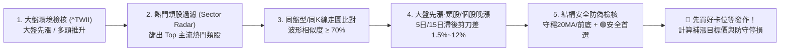

# 📘《技術分析全攻略》CH10~CH12 贏家策略、ETF專家課程、2026 Q&A 與大盤滯後補漲量化規格書

> **文件定位**：永久核心規格書（Course & Quantitative Specification）  
> **涵蓋範圍**：
> 1. **CH10 散戶 QA (10-1 ~ 10-2)**：散戶常見問題、套牢五大解套 SOP、散戶八大錯誤與贏家思維
> 2. **CH11 贏家策略 (11-1 ~ 11-2)**：五大永遠原則、月獲利 5% / 年獲利 60%（六年千萬複利藍圖）、六大進場位置、做多七不買、短線停利 SOP
> 3. **CH12 ETF 專家課程 (12-1 ~ 12-5)**：2026 ETF 新變局、四大誤區（00940 之亂）、高勝率篩選三要點、50/30/20 資產配置、主動式 ETF 五大優勢與 TOP 5 標的
> 4. **2026 Q&A（1007 學員直播問答、理財達人秀、10月助教實戰問答）**：預測失準時間停損、由短做長鐵律、三層進場階梯（B1/B2/B3）、大盤三大上攻條件與三階段資金水位
> 5. **`自己的想法.txt` 原創戰法**：找出與大盤同盤型/同 K 線走圖的熱門類股，利用「大盤先漲、類股晚漲」先買好等發作（大盤同步滯後補漲 ＋ 族群看大哥買小弟）
> 6. **現有 App 模組 (`core/market_sync.py`, `core/sector_radar.py`, `core/app_guideline.py`) 實作對照與強化藍圖**

---

## 第一章：CH10 散戶 QA 核心規則與量化條件 (10-1 ~ 10-2)

### 10-1 散戶常見問題解答

#### 一、股市可以當作事業來經營嗎？
* **核心定調**：股市是一個可以**永續經營的賺錢事業**，具備六大無可比擬的優勢：
  1. **市場最大**：每日千億至數千億成交量的龐大市場，流動性無虞。
  2. **資本最少**：數十萬元（如 60 萬）即可開始創業經營。
  3. **無需店面及設備**：一台電腦走天下，「一指神功」打天下。
  4. **個人經營**：自己就是老闆，無需聘請員工，也無需面對客戶應酬。
  5. **放眼世界**：台股、美股、ETF、期貨等各種金融商品都能操作，機會無限。
  6. **一技在身**：學會技術分析客觀方法，可終身永續經營。

#### 二、為什麼總是「買進就跌，賣出就漲」？
* **根本原因**：缺乏一套客觀獲利的操作方法。
  * **一買就跌（追高盲點）**：看不懂走勢圖與買進時機，隨便聽消息買股、喜歡追逐已連續大漲數天的強勢股，往往買在波段高點，一買就回檔下跌。
  * **一賣就漲（殺低盲點）**：看不懂賣出時機，第一時間跌破均線或停損點該賣沒賣，連續再跌兩三天就恐慌崩潰，往往砍在波段支撐低點，主力進場低接後一賣就漲。
* **量化破解**：
  * 買進只選「多頭回後買上漲」或「盤整剛突破第一根」，且於 **12:40 ~ 13:30 尾盤確認收盤價** 才進場；連漲 $\ge 3$ 天或波段累計漲幅 $> 10\%$ 嚴禁追高。
  * 賣出嚴守第一時間停損（跌破進場 K 低點 / 跌破 5MA / 虧損達 $5\%$），絕不拖延至深跌支撐區才恐慌殺出。

#### 三、為什麼總是「卡在沒波動的股票」？
* **根本原因**：過度相信基本面，缺乏技術面對趨勢的判斷。
  * 股票進入上下振盪盤整時，短時間沒有行情；因「公司基本面不錯」而買進盤整股，資金被卡死無法創造利潤，甚至久盤向下破底造成重大虧損。
* **量化破解**：
  * 盤整趨勢（非頭頭高底底高、均線糾結走平未突破）**不進場做多**，僅可列入「鎖股池」等待帶量長紅突破箱頂（量 $> 20\text{MA}$ 均量 $1.5$ 倍、紅 K 實體 $> 2\%$）才進場。

#### 四、股票套牢的定義、後果與五大實戰解套 SOP
1. **被套牢之量化定義**：
   * 當單筆持股**帳面賠損超過 $10\%$（$\text{Loss} > 10\%$）而仍繼續持有**時，即稱為「被套牢」。
2. **容易被套牢的四大心理**：
   * (1) 不願賠小錢（$3\% \sim 5\%$）賣出；(2) 幻想明後天能上漲；(3) 盲信基本面好捨不得賣；(4) 抱持「不賣就不賠」鴕鳥心態。
3. **被套牢的三大慘痛後果**：
   * (1) 短期三五年不一定能解套（講義經典案例：**大立光 3008** 買在歷史高點 $6075$ 元，套牢 8 年跌至 $1500 \sim 2440$ 元仍未解套）。
   * (2) 公司若經營不善可能減資或下市而血本無歸。
   * (3) 資金失去流動性，錯失其他多頭飆股的複利機會。
4. **被套牢股票的五大處置 SOP（依虧損幅度與趨勢分流）**：

| 套牢分級 | 量化條件 (虧損幅度 & 技術結構) | 標準處置 SOP | 講義代表案例 |
| :--- | :--- | :--- | :--- |
| **Level 1：輕微虧損** | 賠損 **$< 10\%$**，且收盤跌破買進 K 線最低點 | **立刻執行停損出場**（將虧損鎖定在 $10\%$ 以內） | 華經 (2468)、杏一 (4175) |
| **Level 2：中度套牢** | 套牢跌幅 **$10\% \sim 20\%$** | 等待股票反彈，**反彈遇壓不漲（出黑K或上影線）時認賠出場** | 光頡 (3624)、金橋 (6133) |
| **Level 3A：深度套牢 (同股反手空)** | 套牢跌幅 **$> 20\%$**，且**空頭趨勢不變**（頭頭低底底低、月線下彎） | 反彈賣出多單後，**反手做空賺價差解套**：彈後空 ➔ 跌破回補/續空 ➔ 直到出現「底底高」才回補並停止放空 | 致茂 (2360)、凱美 (2375) |
| **Level 3B：深度套牢 (換強勢股)** | 套牢跌幅 **$> 20\%$**，且**空頭趨勢不變** | 反彈賣出後，將資金**換至其它四線多排的多頭強勢股操作**，以多頭獲利彌補虧損 | — |
| **Level 3C：深度套牢 (底部加碼)** | 套牢跌幅 **$> 20\%$**，但低檔**已出現大量止跌打底** | 切勿在下跌中攤平！耐心等待打底完成、**正式反轉為多頭確認（底底高＋站上月線）時再加碼** | — |

5. **股票不被套牢的三大積極作法**：
   * (1) 嚴格執行停損紀律。
   * (2) **每日 5% 警示機制**：每天檢視手上股票，**只要帳面跌幅超過 $5\%$，立即列為「警示股」準備賣出**！
   * (3) 無債一身輕，保持手中全數為賺錢的多頭股票。

---

### 10-2 散戶的錯誤行為與贏家思維（八大錯誤對照表）

| 編號 | 散戶不可犯的錯誤行為 | 散戶盲點與敗因剖析 | 贏家思維與系統量化規則 |
| :---: | :--- | :--- | :--- |
| **1** | **當虧損很小時，不願賠錢出場** | 失敗進場通常都有小賠出場機會（如追高買點失敗、打底失敗破底），卻被情緒左右懷抱希望，拖成深套。 | 遵守迅速停損認賠原則，**跌破進場紅 K 低點、跌破頸線/箱底、或虧損達 $5\%$ 無條件出場，絕無例外**。 |
| **2** | **向下攤平買進，降低成本** | 50元買進跌到40元再買，表面成本降至45元，實則是「加碼正在下跌的空頭弱勢股」，卡死雙倍資金且若續跌至20元將面臨毀滅。 | **波段價差交易嚴禁向下攤平！** 唯有在超長線歷史大底之價值投資且資金充裕分批投入時才適用；技術派只在多頭確認（B1/B2/B3）順勢加碼。 |
| **3** | **想要儘快大撈一筆，夢想一夜致富** | 缺乏方法與紀律，急於求成亂買重押，看錯又不願認賠，往往賠大錢。 | 建立「月獲利 $5\%$、年獲利 $60\%$」的穩健複利目標，每次操作只求穩健 $2.5\% \sim 5\%$ 價差。 |
| **4** | **聽消息、謠言、報紙電視、投顧買股** | 市場消息多為有心人（主力）為出貨而釋放，散戶得知時已是第 N 手落後消息，進場即接刀。 | 杜絕一切消息面干擾，**100% 依據走勢圖（趨勢、K線、均線、成交量四大金剛）** 客觀訊號進出。 |
| **5** | **因高股利、低本益比而買進不漲的股票** | 低本益比不代表會漲（如中華電每年盈餘固定但缺乏成長性，股價牛皮不動），無法賺取波段價差。 | 賺價差要買**「當下有題材、有成長動能、資金聚焦的主流強勢股」**（對應 `sector_radar.py` 熱度前段班）。 |
| **6** | **這一筆賺一點點就趕快獲利了結** | 剛起漲賺 $1\% \sim 2\%$ 就情緒不穩怕跌回而賣掉手上的金雞母，錯失後面主升段大波段。 | 賣出完全依據走勢圖訊號（短線守 5MA 或昨低、波段守 20MA、或高檔爆量長黑），不自己預設立場猜高點。 |
| **7** | **不會看走勢圖，不敢買進價格創新高的股票** | 當股價創新高，**$98\%$ 的散戶認為太高不敢買**，錯失翻倍飆股（如**勤誠 8210** 從 100 飆至 900+、**廣達 2382** 從 80 飆至 280）。 | **「多頭趨勢不變的股票，股價會一直創新高價！」** 創高不追高，等拉回量縮守穩均線出轉折紅 K（回後買上漲）勇敢切入。 |
| **8** | **盤前沒擬定策略，盤中不知反應，盤後不知解讀** | 東看西看隨意買股，買進後不知何時賣、何處遇壓力，毫無依據。 | **盤前**寫清支撐/壓力/停損價；**盤中（12:40~13:30）**依市場反應執行；**盤後**依實戰紀錄檢討改進。 |

---

## 第二章：CH11 贏家策略核心規則與量化條件 (11-1 ~ 11-2)

### 11-1 贏家策略五大「永遠」原則與停損正面思考

#### 一、贏家五大「永遠」鐵律
1. **永遠控制風險，嚴格執行停損**。
2. **永遠集中火力**：資金不要分散買太多檔股票，**嚴格集中操作 $2 \sim 5$ 檔股票**，便於管理及專注追蹤股票變化。
3. **永遠汰弱換強**：手中只留強勢上漲的股票，弱勢不漲或破線者果斷剔除。
4. **永遠只操作符合技術分析高勝率條件的股票**。
5. **永遠相信技術分析，紀律操作**。

#### 二、停損的正面思考（五點心法）
1. 停損是為了賺錢所設的。
2. 小賠容易快速反敗為勝。
3. 當下小賠賣出，避開快速下跌的風險；如果賣錯，再伺機買回也不會遺憾。
4. 當下小賠高價賣出，下跌止跌反轉再低價買回，何樂不為。
5. 留得青山在，不怕沒柴燒。

---

### 11-2 月獲利 5%、年獲利 60% 的獲利目標與六年千萬計畫

#### 一、資金與獲利目標拆解
* **基準固定資金**：**$60$ 萬元**
* **月度目標**：每月 $22$ 個交易日（$4$ 週）獲利 **$5\% = 30,000$ 元**
* **雙週拆解目標**：每月僅需成功操作 **$2$ 次**（每 $2$ 週操作 $1$ 次），每次僅需獲利 **$2.5\% = 15,000$ 元**！
* **操作策略定調**：短線操作，嚴守短線做多紀律。

#### 二、六年一千萬複利滾動模型（每年 60% 成長）
$$\text{期末資產} = 60\text{萬} \times (1 + 60\%)^n$$
* **第 1 年**：$60\text{萬} \rightarrow \mathbf{96\text{萬}}$（年獲利 $+36$ 萬）
* **第 2 年**：$96\text{萬} \rightarrow \mathbf{153.6\text{萬}}$（年獲利 $+57.6$ 萬）
* **第 3 年**：$153.6\text{萬} \rightarrow \mathbf{245.76\text{萬}}$（年獲利 $+92.16$ 萬）
* **第 4 年**：$245.76\text{萬} \rightarrow \mathbf{393.22\text{萬}}$（年獲利 $+147.46$ 萬）
* **第 5 年**：$393.22\text{萬} \rightarrow \mathbf{629.15\text{萬}}$（年獲利 $+235.93$ 萬）
* **第 6 年**：$629.15\text{萬} \rightarrow \mathbf{1,006.63\text{萬}}$（🎉 **第六年正式突破一千萬目標！**）

#### 三、選股與進場量化條件
1. **選股三大必要條件**：
   * `條件 1`：**多頭確認**（轉折波頭頭高 $\text{Peak}_t > \text{Peak}_{t-1}$ 且 底底高 $\text{Trough}_t > \text{Trough}_{t-1}$）。
   * `條件 2`：**均線 4 線多排**（$5\text{MA} > 10\text{MA} > 20\text{MA} > 60\text{MA}$，且均線方向向上）。
   * `條件 3`：**KD 多排向上**（$K > D$ 且 $K$ 值翻揚向上 / 黃金交叉）。
2. **進場 K 線必備條件**：
   * **價漲**：收盤價 $>$ 昨日收盤價。
   * **量增**：今日成交量 $>$ 昨日量 或 $> 5\text{MA}/20\text{MA}$ 均量（攻擊量 $\ge 1.25$ 倍）。
   * **紅 K 實體棒 $> 2\%$**：$(\text{Close} - \text{Open}) / \text{PrevClose} \ge 2\%$（或當日漲幅 $\ge 2\%$ 且實體飽滿大於影線）。
   * **收盤突破 5 均**：$\text{Close} > 5\text{MA}$。
   * **突破昨日最高點（過昨高）**：$\text{Close} > \text{High}_{t-1}$。
   * **KD 黃金交叉**：KD 指標同步轉強向上。
3. **六大標準進場位置**：
   1. **多頭「回後買上漲」**：多頭回檔破 5MA 測支撐不破前低，出量增實體紅 K 重新站上 5MA 過昨高。
   2. **「盤整突破」**：區間箱型整理或底部型態完成，帶大量長紅突破箱頂頸線。
   3. **多頭「K 線橫盤突破」**：基準紅 K 後連續 $\ge 3$ 天收盤價包覆在基準 K 高低點內，隨後帶大量紅 K 收盤突破橫盤最高點。
   4. **多頭「ABC 修正突破下降切線」**：多頭回檔走 A-B-C 旗型修正（20MA 維持向上），帶大量紅 K 實質突破原始下降切線（破切）。
   5. **「弱勢回檔，大量黑 K 的突破」**：回檔出現大量黑 K 洗盤後，帶大量紅 K 收盤強勢越過該大量黑 K 的最高價（主力換手成功）。
   6. **「突破緩角度往上的上升軌道線」**：原本沿緩升軌道線推升，帶大量長紅突破上升軌道線上緣，進入加速噴出主升段。

#### 四、做多七大禁忌位置（「做多七不買」量化過濾網）
1. **盤底還沒有反轉多頭，沒有三線多排勿進場**：未完成多頭確認且無 $5\text{MA} > 10\text{MA} > 20\text{MA}$ 嚴禁摸底。
2. **上漲第 3 根以上位置勿追高**：連續上漲天數 $\text{up\_days} \ge 3$（或自起漲點累計漲幅 $> 10\%$）嚴禁追高。
3. **重大壓力前勿進場**：週線（週 K 線）遇壓力前、季線（60MA）下彎壓力前、前方盤整區套牢壓力前、大量下跌黑 K 或長上影線前（上方距壓力空間 $< 3\%$）勿進場。
4. **回檔跌破月線再上漲未突破月線勿進場**：股價跌破 20MA 後反彈，若收盤尚未重新站回 20MA 之上，屬月線下彎反彈，嚴禁做多。
5. **趨勢盤整或空頭勿進場做多**：非多頭趨勢（除底部型態帶量突破第一根外）不進場做多。
6. **連續急漲高檔的大量長紅 K 高檔勿進場**：波段高檔連續急漲後爆出巨量長紅 K，多為主力拉高誘多出貨，嚴禁追進。
7. **多頭進場位置，是「價漲的黑 K」勿進場**：雖跳空開高使收盤價上漲，但當日 K 線為開高走低收黑 K（$\text{Close} < \text{Open}$），代表上檔賣壓沉重，嚴禁進場。

#### 五、短線停利雙軌策略（講義案例：南亞科 2408、智伸科 4551）
1. **常態短線停利**：帳面獲利達 **$3\% \sim 5\%$ 以上** 準備隨時逢壓或破線停利。
2. **強勢噴出停利**：若個股**連續上漲超過 $3$ 天，且波段漲幅超過 $10\%$**，改採：
   * **K 線戰法（智慧 K 線）停利**：每日收盤不破前一日 K 線最低點續抱，一旦收盤跌破前一日 K 線最低點（或跌破 5MA）立即停利出場；
   * 或 **盤中 5 分 K 轉空頭（頭頭低底底低破均線）** 即時獲利出場。

---

## 第三章：CH12 ETF 專家課程核心規則與量化條件 (12-1 ~ 12-5)

### 12-1 2026 年 ETF 投資新變局
* **核心反思**：過去幾年高股息 ETF 橫掃市場，但進入成熟期後，許多高股息 ETF 陷入**「左手換右手（拿收益平準金配息）」**或**「賺了股息、賠了價差」**的窘境。
* **投資本質公式**：
  $$\text{總報酬率 (Total Return)} = \text{資本利得 (Capital Gain)} + \text{股息收入 (Dividend Yield)}$$
  絕不應為了追求表面高配息率而犧牲資產實質增長（資本利得）的機會。

### 12-2 ETF 四大誤區與量化排雷指標（含 00940 之亂啟示）
> 📌 **歷史教材「00940 之亂」**：元大台灣價值高息 (00940) 於 5 天募集期吸金 $1,752$ 億元創紀錄，2024/04/01 掛牌首日爆出 $134$ 萬張天量、受益人破 $70$ 萬人，但掛牌後長期破發在 $9.2 \sim 9.7$ 元震盪，印證盲目追逐高息巨嬰 ETF 的風險。

| 誤區編號 | 散戶常見誤區觀念 | 真相揭曉與內耗機制 | 量化觀察與排雷指標 |
| :---: | :--- | :--- | :--- |
| **誤區一** | **配息率越高越好** （以為配息 10% 就是賺 10%） | 若無法填息，配息只是「左手換右手」，領到的是自己的本金。 | 1. 檢查**「收益平準金佔比」**是否過高。 2. 嚴看**「平均填息天數」**與**「填息成功率」**，除息後遲遲無法填息者剔除。 |
| **誤區二** | **規模大就是安全？** （幾千億規模隨便買都好） | 規模過大雖無下市風險，但有**「大象轉身難（流動性與績效鈍化）」**風險：換股買賣數量龐大導致「買貴賣低」吃掉淨值，擴大**追蹤誤差**。 | 優先選擇**規模適中（約數百億規模，如 $100\text{億} \sim 500\text{億}$）且日均成交量活躍**的標的，注意巨型 ETF 績效是否落後追蹤指數。 |
| **誤區三** | **買多支高股息 ETF 以為分散風險** | 許多高息 ETF 選股邏輯趨同、過度集中特定成熟產業，**前十大成分股重疊度高達 $70\%$ 以上**；2025 年部分超高息 ETF 含息總報酬落後大盤超過 **$15\%$**。 | 檢視投資組合中各檔 ETF 之**「前十大成分股重疊率」**（控制在 $< 40\%$），透過「市值型＋高息低波型＋主動/科技攻擊型」真正分散。 |
| **誤區四** | **忽視「換股成本」，以為換股越快越好** | 頻繁換股產生高額交易稅與手續費，全數內扣啃食淨值本金。 | 嚴查 ETF **「年化週轉率」**與**「總內扣費用率」**，剔除高週轉內耗型標的。 |

### 12-3 2026 ETF 高勝率決策與黃金資產配置 (50 / 30 / 20 模型)

#### 一、篩選 ETF 三大硬指標
1. **從「過去配多少」轉向「未來賺多少」**：成分股企業具備實質獲利成長性（EPS 成長），配息與價差才可持續。
2. **嚴查「填息力（填息率）」而非「配息頻率（月配/季配）」**：填息率才是資產有無實質成長的硬指標。
3. **內扣成本的「隱形天花板」**：
   $$\text{總費用率（管理費 + 保管費 + 交易手續費）} \le \mathbf{0.8\%}$$
   在 2026 高競爭環境下，總費用率若超過 **$0.8\%$** 即屬偏高，長期將嚴重侵蝕複利。

#### 二、2026 官方建議資產配置矩陣（50% 核心 + 30% 衛星 + 20% 攻擊）

| 配置類別与權重 | 核心目標 | 風險等級 | 官方指定代表標的 | 策略說明與選股邏輯 |
| :--- | :--- | :---: | :--- | :--- |
| **核心配置 (50%)** | **市值型 ETF** | 中 | • **`0050`** (元大台灣50) • **`006208`** (富邦台50) • **`00922`** (國泰台灣領袖50) | 市值型標的含息總報酬率長期穩定領先；`0050`/`006208` 鎖定台股最具競爭力龍頭，`00922` 加入低碳與企業轉型權重。 |
| **衛星配置 (30%)** | **高息型 ETF** | 中低 | • **`00713`** (元大台灣高息低波) • **`00878`** (國泰永續高股息) • **`00919`** (群益台灣精選高息) | `00713` 具備低波動因子，空頭防禦表現極佳；`00878` 換股週轉率與配息最平衡；`00919` 在填息能力優異時可博取較高股息。 |
| **攻擊配置 (20%)** | **主動式 ETF / 產業型 ETF** | 中高 | • **績優主動式 ETF** (`00981A` 等) • **`00830`** (國泰費城半導體) | 2026 進入主動式 ETF 戰場，由專業經理人靈活應對產業輪動；搭配 `00830` 鎖定全球與半導體上游核心成長動能。 |

### 12-4 ~ 12-5 主動式 ETF 五大優勢與 2026 精選五大主動式 ETF

#### 一、主動式 ETF 五大核心優勢（2026 主動式 ETF 元年）
1. **優勢一：破解「成分股僵化」的束縛**：不必等每半年固定換股，經理人發現成分股基本面轉壞可立即汰弱留強，避開下跌風險。
2. **優勢二：應對「AI 產業大分化」時代**：2026 年 AI 進入實質獲利考驗期，經理人透過實地訪查與深度研究，過濾空有題材無獲利的泡沫股，鎖定真獲利領先者。
3. **優勢三：解決「大象轉身難」的交易成本**：可採取「分批進場」或「擇時操作」，避免在固定換股日與數千億被動資金擠門縫，降低衝擊成本與追蹤誤差。
4. **優勢四：空頭市場的「防禦性操作」**：出現系統性風險時，可適度調整現金比率或轉入防禦性價值股避險（不像被動 ETF 必須強制滿水位持股）。
5. **優勢五：追求「超額報酬 ($\alpha$, Alpha)」的機會**：大盤漲勢增加時加碼、減緩時調節，並提前發掘尚未被指數納入的「黑馬潛力股」。

#### 二、主動式 ETF 三大挑選標準與 TOP 5 觀察清單
* **三大挑選標準**：
  1. **投信品牌**：優先選擇台股主動共同基金長期績效優異之投信（國泰、元大、富邦、復華、統一、群益、野村等）。
  2. **經理人歷史**：檢視經理人過去數年操盤台股基金之實戰夏普值與超額報酬。
  3. **持股透明度**：檢視每日公告之持股方向是否與標榜策略一致。
* **講義點名 2026 五大主動式台股 ETF 名單**：

| 名次 | ETF 代號 | ETF 名稱 | 主要投資標的 | 資產規模 | 參考績效表現 (至2025年底) |
| :---: | :---: | :--- | :--- | :---: | :---: |
| **1** | **`00981A`** | **主動統一台股增長** | 台股大型成長股 | 475 億元 | $+65\% \sim +70\%$ |
| **2** | **`00982A`** | **主動群益台灣強棒** | 台股主動選股 | 281 億元 | $+44\% \sim +45\%$ |
| **3** | **`00990A`** | **主動元大 AI 新經濟** | AI / 新經濟主題 | 195 億元 | $+20\%$ |
| **4** | **`00991A`** | **主動復華台灣未來 50** | 台股未來成長股 | 149 億元 | $+4\%$ 左右 (2025年底掛牌) |
| **5** | **`00980A`** | **主動野村台灣優選** | 台股主動選股 | 90~100 億元 | $+40\% \sim +54\%$ |

* **ETF 技術面進場鐵則（結合 10/14 助教官方指引）**：
  * 無論操作市值型 (`0050`) 或主動式 ETF (`00981A`)，技術面進場同樣必須遵守**「三線/四線多排 ＋ 月線（20MA）向上翻揚」**！
  * 短波段以日線「回後買上漲（站上 5MA 過昨高）」或「盤整突破」進場；中長波段可沿上揚的 **20MA（月線）** 進場與防守，月線下彎時嚴禁買進。

---

## 第四章：2026 Q&A（1007 直播問答、理財達人秀與助教實戰指引）

### 4-1 2026/10/07 學員專屬直播 Q&A 核心問答全解（五大模組 31 題精華）

#### 模組一：買點與進場條件
1. **回後買上漲第 1 根 vs 第 2、3 根進場（Q1）**：
   * 若回檔後第 1 根紅 K 仍在重要均線或壓力之下、或漲幅未達 $2\%$（「位置符合但條件未足」），**可以等第 2 或第 3 根真正帶量突破壓力且符合所有進場條件（站上 5MA、過昨高、紅K $> 2\%$、量增）再補進場**！但若自起漲已連漲 $\ge 3$ 根且累計漲幅 $> 10\%$ 則算追高，必須放棄。
2. **隔天補進場要一早進還是等尾盤（Q2）**：
   * 原則上技術分析以**尾盤（12:40 ~ 13:30）接近收盤確認 K 線實體**再進場最安全（防開高走低價漲黑 K 或長上影線）。
   * 唯一例外：底部均線糾結 2~3 個月後第一根長紅突破，次日若未跳空漲停鎖死，在**平盤或小漲 $+2.5\%$ 黃金區間內**可逢低卡位，但若開高超過 $+5\%$（禁追天花板）則絕不追高。
3. **剛形成四線多排是否等於追高？5MA 下彎能否買回後買上漲？（Q4 + 10/22 助教修正）**：
   * 當股價剛形成四線多排但已連漲一大段時，**不在急漲高點追買，而是鎖股等待第一次拉回的「回後買上漲」**！
   * **破除迷思**：多頭回檔必先跌破 5MA，跌破期間 5MA 因扣抵自然會微幅下彎，此時暫時非四線多排；只要**月線（20MA）維持向上、未破前波底（底底高）**，第一根轉折紅 K 收盤站上 5MA 且過昨高，**無須要求當下 5MA 斜率向上**，即為標準回後買上漲第一買點！
4. **剛形成四線多排但接近前高重壓區能否進場？（Q5）**：
   * 若現價距離前方重壓區空間 $< 3\%$，原則上遵守「壓力前勿進」；但若當天**爆出攻擊大量（$> 20\text{MA}$ 量 $1.5$ 倍）直接長紅穿破前高重壓**，則由「壓力前」轉化為「標準 B2 盤整/前高突破買點」，可在嚴守頸線/紅 K 低點停損下進場。
5. **盤整突破是否一定要多頭趨勢與四線多排？（Q6）**：
   * 完成底部型態（如 W 底、頭肩底、箱型底、圓弧底）的「盤整突破」，本身就是由盤轉多的起點，因此**即使季線（60MA）仍在上方或微幅下彎，只要短期三線多排且帶量長紅（實體 $> 2\% \sim 3.5\%$）突破頸線即可進場**（穩健者可等突破後回測頸線有守再進）。
6. **「盤整」與「K 線橫盤」同時存在時以哪個突破為買點？（Q7）**：
   * **K 線橫盤**（單根基準 K 包覆 $\ge 3$ 天高低點）突破屬微觀極短線轉強訊號，可輕倉試單（B1 概念）；**區間盤整箱頂**突破則是波段大結構突破，為標準重倉買點（B2 概念）。
7. **「醜圓弧底」與頭肩底底部糾結特徵（Q8）**：
   * 實戰線圖常有變形（不規則圓弧底），真正必備的核心特徵是：**左方急跌後量縮止跌、底部平緩震盪均線糾結（通常 $\ge 40 \sim 60$ 天）、右方溫和放量緩步墊高（底底高）、回檔不破圓弧波段 $1/2$ 價與 20MA 月線**。
8. **不只漲三波的強勢股能否繼續操作？需配其他指標嗎？（Q10）**：
   * 多頭趨勢不變（守穩月線、頭頭高底底高），「有三波做三波、有五波做五波」！但當波段累計漲幅**翻倍（$> 100\%$）進入高檔後，全面改採短線 5MA 操作（破 5MA 即走，不做長線）**。只需看「趨勢、K線、均線、成交量」四大金剛搭配 KD 即可，無須疊加複雜指標。
9. **週線進場訊號如何搭配日線切入？（Q11）**：
   * 週 K 線必須等到**週五收盤**才完成確認。實戰標準流程是：**以週 K 線確認中長線大趨勢多頭與上方無週線重壓，再回到「日 K 線」抓站上日 5MA 的回後買上漲或突破買點切入**，進場成本更低、停損更精準！

#### 模組二：資金配置與操作模式
1. **初學者小額分散試單 vs 集中火力（Q1）**：
   * 總持股檔數嚴格控制在 **$2 \sim 5$ 檔**。可運用**「B1 輕倉試單（$20\% \sim 30\%$）➔ 市場跑出強弱後，淘汰不漲弱勢股，將資金集中加碼到走出 B2 帶量突破的強勢股（$60\% \sim 70\%$）」**，完美兼顧容錯率與資金效率。
2. **如何規劃一檔股票「從短線操作轉成長線投資」？（Q3）**：
   * **由短做長絕對鐵律**：**嚴禁買進套牢後自我安慰改做長線！**
   * 正確轉換 SOP：一律先用**短線買點（站上 5MA）**進場 ➔ 當股價順利拉開**帳面獲利達 $10\%$ 以上**且均線呈現 **4 線多排**時 ➔ 才將移動停利防守線由 5MA 切換為 **20MA（月線）**（或採 **3 張部位管理法**：破 5MA 賣 $1/3$、破 10MA 賣 $1/3$、破 20MA 月線賣最後 $1/3$），用市場給的利潤去抱大波段長線！

#### 模組三：趨勢、轉折波與趨勢線
1. **有效轉折 vs 盤中雜訊判定（Q1）**：
   * 以收盤價**實質站上 5MA 往左找最低點（底）**、**實質跌破 5MA 往左找最高點（頭，包含跌破 5MA 當根 K 棒最高點）**。未穿越 5MA 的小幅震盪皆視為行進間雜訊，不畫轉折。
2. **何時從「畫轉折波」改成「直接看盒型區間」？（Q2）**：
   * 當股價不再創出顯著的頭頭高或底底低，而是在一個上下界限內反覆穿越均線（均線走平糾結）時，直接視為**「箱型盤整區間（Box Range）」**，只盯箱頂最高壓力與箱底最低支撐，中間小轉折全數忽略。
3. **下降趨勢線（切線）兩個基準高點選取法則（Q3）**：
   * 連接**「波段最高點」與「進入修正段後最具代表性的次高轉折點」**（且切線不可貫穿中間 K 棒實體）。當帶量長紅收盤實質越過該切線（**必須真破切**，頂在切線下緣不算突破）且 20MA 走平向上，即為有效突破。

#### 模組四：停損停利、預測失準與飆股基因
1. **「預測失準就出場（時間停損）」實戰量化定義（停損停利 Q3）**：
   * **量化條件**：進場後經過 **$3 \sim 5$ 個交易日（$T+3 \sim T+5$）**，股價虽未跌破停損點（「結構沒壞但不漲」），卻一直在成本區附近狹幅原地打轉（漲跌幅在 **$-2\% \sim +2\%$** 內）且成交量萎縮無攻擊力道。
   * **處置 SOP**：視為「多頭爆發預測失準」，時間就是資金機會成本，應主動於平盤附近微賺或微損出場，換股至已發動的主流強勢股！
2. **如何從前面線型挑選容易飆漲的潛力股？（選股 Q2）**：
   * **避開牛皮股特徵**：前面走勢「遇壓有壓、遇撐有撐」、滿滿長上下影線（刷洗劇烈、主力控盤意願低）。
   * **鎖定飆股基因**：(1) 前段整理 K 線乾淨、上下影線少；(2) 底部四條均線高度平躺糾結達 $2$ 個月（$40 \sim 60$ 天）以上；(3) 啟動時紅 K 實體飽滿（$> 3\%$）且帶攻擊量；(4) 身處當下全市場資金最集中的 Top 主流熱門族群。

---

### 4-2 理財達人秀：朱家泓老師大盤環境診斷與三階進場體系

#### 一、大盤（`^TWII`）三大上攻確認條件
1. **出攻擊量**：大盤單日成交量回到 5日/20日均量之上（或達 $8,000$ 億級別攻擊量能）。
2. **過前日黑 K 高點**：收盤指數突破前一日黑 K 棒最高點，化解短線空方賣壓。
3. **站回月線（20MA）且月線走平翻揚**：指數收盤站穩 20MA 與 5MA 操盤線，且均線斜率走平向上。

#### 二、大盤三階段資金控管紀律（環境燈號）
* 🟢 **多頭攻擊波（站穩 20MA 與 5MA ＋ 具備攻擊量/過昨高）**：
  * **建議持股水位**：**$60\% \sim 70\%$**（順勢做多主流強勢股，嚴守 5MA 移動停利）。
* 🟡 **震盪量縮整理期（多空拉鋸、量能未全面放大或單一均線失守）**：
  * **建議持股水位**：嚴格控制在 **$40\%$ 以下**（只做強勢多頭龍頭股、做短線快進快出，不長抱）。
* 🔴 **空頭破線期（跌破 20MA 月線且月線下彎助跌，且破 5MA）**：
  * **建議持股水位**：**$0\% \sim 20\%$**（保留 $8$ 成以上現金，「跌市選股、漲市買股」，切勿盲目摸底接刀）。

#### 三、老朱三層進場階梯戰法（B1 / B2 / B3 量化體系）
* **🟢 B1（第 1 買點 · 底部轉折試單）**：
  * **條件**：回測打第二隻腳不破前低（$\text{Leg}_2 \ge \text{Leg}_1 \times 0.992$），當日收紅 K 站上 5MA。
  * **倉位與防守**：輕倉試單 **$20\% \sim 30\%$**；停損守第二隻腳最低點。
* **🔥 B2（第 2 買點 · 標準多頭確立 · 核心重倉買點）**：
  * **條件**：帶量長紅突破前波頸線高點（頭頭高＋底底高 $100\%$ 確立）。
  * **倉位與防守**：標準重倉 **$60\% \sim 70\%$**；停損守突破頸線或長紅 K 低點。
* **🚀 B3（第 3 買點 · 波段加碼追價）**：
  * **條件**：突破中長期大下降切線 / 大箱頂，或主升段回後買上漲再創高。
  * **倉位與防守**：順勢加碼或小量短線追價；嚴守 5MA 移動停利。
* **進場價位區間控制**：
  * **黃金買點區**：突破發動價 $+0\% \sim +2.5\%$（標準部位進場）。
  * **輕度追價區**：突破發動價 $+2.5\% \sim +5.0\%$（部位減半，防短線震盪）。
  * **禁追天花板**：突破發動價 **$> +5.0\%$**（嚴禁追高，等待拉回測線）。

---

## 第五章：`自己的想法.txt` 原創戰法規格——大盤同盤型熱門類股滯後補漲系統

### 5-1 原創核心構想原文
> **「能否找出和大盤一樣盤型，或一樣 K 線走圖的熱門類股。這樣就可以等大盤先漲，然後類股晚漲的股票，就可以先買好，等他發作。」**

### 5-2 戰法邏輯與量化工程拆解
此構想結合了**「Top-Down 總體大盤共振」**、**「主流熱門類股資金聚焦」**與**「Lead-Lag 領先滯後時間差套利」**三大維度，完整量化規則如下：

#### 維度一：找出「和大盤一樣盤型 / 一樣 K 線走圖」的量化指標
1. **走勢幾何相似度（Shape Correlation, `shape_corr`）**：
   * 取最近 $N$ 個交易日（預設 $N = 40$ 日）大盤與類股/個股的收盤價序列，進行 Min-Max 歸一化（映射至 $[0, 1]$ 區間）：
     $$S_{\text{norm}}(t) = \frac{P_s(t) - \min(P_s)}{\max(P_s) - \min(P_s)}, \quad M_{\text{norm}}(t) = \frac{P_m(t) - \min(P_m)}{\max(P_m) - \min(P_m)}$$
   * 計算兩條歸一化曲線之皮爾森相關係數（Pearson Correlation）：
     $$\text{ShapeCorr} = \text{corr}(S_{\text{norm}}, M_{\text{norm}}) \times 100\%$$
   * **量化門檻**：$\text{ShapeCorr} \ge 65\% \sim 75\%$（代表高低轉折、打底、洗盤軌跡與大盤高度同構）。
2. **報酬率同步率（Return Correlation, `corr_return`）**：
   * 計算每日漲跌幅百分比序列之相關係數，確認日常多空節奏與大盤共振（$\ge 50\%$）。
3. **K 線走圖與盤型結構同構（Pattern & K-Line Structure Match）**：
   * 大盤處於「回後買上漲 / 底底高 / 箱型整理突破 / 站穩 20MA」時，目標類股與個股同樣處於「底底高、守穩 20MA、箱型蓄勢待突破或剛回測 5MA/20MA 有守」之同構盤型。

#### 維度二：鎖定「熱門類股（Hot Sectors）」而非冷門孤兒股
1. **類股熱度綜合評分（`heat_score` in `sector_radar.py`）**：
   * **資金集中度（$45\%$ 權重）**：該類股成交金額佔全市場總成交金額比例（`turnover_share`）。
   * **族群漲幅強度（$35\%$ 權重）**：該類股內部成分股平均漲跌幅（`avg_chg`）。
   * **多頭齊漲廣度（$20\%$ 權重）**：族群內站上 5MA 且收紅之比例（`bull_ratio`）。
2. **熱門類股篩選**：
   * 優先鎖定 `🔥 超熱門主流 (Rank 1~5)` 或 `⚡ 資金聚焦 (Rank 6~12)` 的主流類股（如 AI 伺服器、散熱、半導體、CPO 光通訊、重電、探針卡等），確保場內大資金在該類股駐留，大盤漲完後資金必然優先點火這些熱門類股！

#### 維度三：捕捉「大盤先漲、類股/個股晚漲」的領先-滯後剪刀差（Lead-Lag Gap）
1. **5 日 / 15 日滯後差距計算**：
   $$\text{LagGap}_{5d} = \text{Return}_{\text{Mkt}, 5d} - \text{Return}_{\text{Stock/Sector}, 5d}$$
   $$\text{LagGap}_{15d} = \text{Return}_{\text{Mkt}, 15d} - \text{Return}_{\text{Stock/Sector}, 15d}$$
2. **最佳埋伏窗口（「先買好、等發作」量化區間）**：
   * **強烈滯後補漲區**：$\text{ShapeCorr} \ge 75\%$ 且 $\text{LagGap}_{5d} \in [3.0\%, 15.0\%]$（大盤已率先上攻拉開 $3\%$ 以上差距，而同盤型熱門股剛在均線處蓄勢待發）。
   * **溫和滯後待發區**：$\text{ShapeCorr} \ge 70\%$ 且 $\text{LagGap}_{5d} \in [1.0\%, 3.0\%]$。
   * **雙層外溢模型**：
     * **第一層（大盤 $\rightarrow$ 熱門類股）**：大盤指數先漲，同盤型之熱門類股指數/均值晚漲。
     * **第二層（熱門類股大哥 $\rightarrow$ 同族群小弟）**：熱門類股中領頭羊（大哥）先漲，同族群同盤型之二線股（小弟）晚漲（動能剪刀差 $\text{SpilloverGap} = \text{Leader}_{5d} - \text{Follower}_{5d} \ge 1.0\%$）。

#### 維度四：嚴格防偽濾網（區分「真蓄勢待發」與「真弱勢破線」）
* 為了確保「晚漲」是因為主力壓盤洗盤蓄勢、而非基本面或技術面崩壞，必須通過三大防偽檢核：
  1. **均線與低點防線**：收盤價守穩月線（$\text{Close} \ge 20\text{MA} \times 0.965$）且絕未跌破近 20 日波段最低點（$\text{Close} \ge \text{Low}_{20} \times 1.01$）。
  2. **14 大淘汰與 7 不買把關**：安全評級必須為 **`🟢 安全首選`**（排除高檔爆量連三黑、空頭排列、上方緊貼巨量黑 K 套牢區）。
  3. **大盤環境熔斷機制**：大盤本身必須處於「多頭攻擊」或「止跌回穩站上 5MA/20MA」；若大盤正在破線下殺（跌破 5MA 且 5MA 下彎），全面暫停滯後補漲買進（防範「假補漲、真補跌」）。

---

## 第六章：與現有 App 模組之實作對照表與強化建議

以下針對現有程式碼模組 [`core/market_sync.py`](file:///c:/Users/ivancheng/Desktop/Introduction/(台股)Stocks/2026/技術分析全攻略/core/market_sync.py)、[`core/sector_radar.py`](file:///c:/Users/ivancheng/Desktop/Introduction/(台股)Stocks/2026/技術分析全攻略/core/sector_radar.py)、[`core/app_guideline.py`](file:///c:/Users/ivancheng/Desktop/Introduction/(台股)Stocks/2026/技術分析全攻略/core/app_guideline.py) 及主程式 [`app.py`](file:///c:/Users/ivancheng/Desktop/Introduction/(台股)Stocks/2026/技術分析全攻略/app.py) 進行逐項盤點對照：

### 6-1 模組實作狀態總覽對照表

| 課程章節 / 戰法模組 | 核心規格項目 | 對應現有程式碼檔案與函式 | 實作狀態 | 現況說明與待強化缺口 (Gap Analysis) |
| :--- | :--- | :--- | :---: | :--- |
| **CH10 散戶 QA** (10-1 ~ 10-2) | 1. 散戶八大錯誤、一買就跌/一賣就漲、不敢買創高、禁向下攤平 | • [`core/app_guideline.py`](file:///c:/Users/ivancheng/Desktop/Introduction/(台股)Stocks/2026/技術分析全攻略/core/app_guideline.py) (`t_faq`, 第六章) • [`core/ai_assistant.py`](file:///c:/Users/ivancheng/Desktop/Introduction/(台股)Stocks/2026/技術分析全攻略/core/ai_assistant.py) (`COURSE_KNOWLEDGE`) | ✅ **已完整實作** | 已完整內建於使用手冊「避雷守則」與 AI 助教知識庫中。 |
| **CH10 散戶 QA** (10-1 套牢處理) | 2. 套牢定義（賠 $>10\%$）、每日跌幅 $>5\%$ 警示股、**五大解套 SOP**（$<10\%$ 停損、$10\sim20\%$ 反彈出、`>20%` 反手做空/換強勢股/打底加碼） | • [`core/ai_assistant.py`](file:///c:/Users/ivancheng/Desktop/Introduction/(台股)Stocks/2026/技術分析全攻略/core/ai_assistant.py) (`股票套牢本質與五大解套SOP`) • [`core/copilot.py`](file:///c:/Users/ivancheng/Desktop/Introduction/(台股)Stocks/2026/技術分析全攻略/core/copilot.py) (`inspect_portfolio`) | 🟡 **部分實作** (可強化互動診斷) | AI 助教已有文字知識庫；【持股守護神】有 $-5\%$ 砍單提醒，但若使用者登錄已深套 $>10\%$ 或 $>20\%$ 之舊持股，可進一步自動觸發「CH10 專屬五級解套劇本診斷卡（反彈壓力價、反手空點位或換股建議）」。 |
| **CH11 贏家策略** (11-1 ~ 11-2) | 1. 五大永遠原則、集中 $2\sim5$ 檔、月獲利 $5\%$ / 年獲利 $60\%$（60萬六年千萬複利表） | • [`core/app_guideline.py`](file:///c:/Users/ivancheng/Desktop/Introduction/(台股)Stocks/2026/技術分析全攻略/core/app_guideline.py) (`t_core`, 第一章) • [`core/ai_assistant.py`](file:///c:/Users/ivancheng/Desktop/Introduction/(台股)Stocks/2026/技術分析全攻略/core/ai_assistant.py) | ✅ **已完整實作** | 手冊第一章與 Tab 1 已完整呈現五大永遠原則與 60 萬六年千萬複利進度表。 |
| **CH11 贏家策略** (11-2 選股與進場) | 2. 六大高勝率進場位置、進場 K 線 4 要件（價漲量增、紅K $>2\%$、過5MA、過昨高）、做多七不買排查 | • [`core/signal_detector.py`](file:///c:/Users/ivancheng/Desktop/Introduction/(台股)Stocks/2026/技術分析全攻略/core/signal_detector.py) • [`core/screener.py`](file:///c:/Users/ivancheng/Desktop/Introduction/(台股)Stocks/2026/技術分析全攻略/core/screener.py) • [`core/app_guideline.py`](file:///c:/Users/ivancheng/Desktop/Introduction/(台股)Stocks/2026/技術分析全攻略/core/app_guideline.py) (`t_chart`) | ✅ **已完整實作** | 個股技術分析與選股池已全面實作六大買點、尾盤 4 要件與做多七不買自動排查儀。 |
| **CH12 ETF 專家課程** (12-1 ~ 12-5) | 1. **ETF 專屬戰情室 / 專區**： • 四大誤區排雷（平準金、規模鈍化、成分股重疊 $>70\%$、內扣費用 $>0.8\%$ 天花板、填息力） • **2026 黃金配置 50/30/20 模型**（市值型 `0050`/`006208`/`00922`、高息型 `00713`/`00878`/`00919`、攻擊型 `00830`） • **2026 五大主動式 ETF 專區**（`00981A`, `00982A`, `00990A`, `00991A`, `00980A`）與技術面三線多排/月線進場訊號 | • [`core/ai_assistant.py`](file:///c:/Users/ivancheng/Desktop/Introduction/(台股)Stocks/2026/技術分析全攻略/core/ai_assistant.py) (僅有 `ETF月線操作三線多排鐵則` 簡短條目) • `core/market_sync.py` / `app.py` / `core/app_guideline.py`：**目前尚無 CH12 ETF 專屬模組與 UI 分頁** | 🔴 **尚未實作** (**重點強化項目 1**) | **【關鍵缺口】**： 1. `data/tw_stock_list.json` 與選股器尚未建立獨立的 **「CH12 2026 ETF 專家配置與主動式 ETF 雷達專區」**。 2. 尚未將 2026 五大主動式 ETF (`00981A`~`00980A`) 與 50/30/20 核心衛星標的整合為專屬監控看板（含三線多排/20MA翻揚檢核、內扣費用率 $\le 0.8\%$ 標示、填息與波段買點掃描）。 3. `app_guideline.py` 與 `ai_assistant.py` 尚未納入 CH12 完整知識庫。 |
| **2026 Q&A** (1007 問答 & 理財達人秀) | 1. **理財達人秀大盤環境診斷**：三大上攻條件（攻擊量、過昨高、站回20MA且翻揚）與三階段建議資金水位（60~70% / $\le 40\%$ / 0~20%） | • [`core/market_sync.py`](file:///c:/Users/ivancheng/Desktop/Introduction/(台股)Stocks/2026/技術分析全攻略/core/market_sync.py) (`calculate_market_environment_guidance`) | ✅ **已完整實作** | 已於 `market_sync.py` 實作大盤環境燈號與資金水位建議。 |
| **2026 Q&A** (1007 問答 & 理財達人秀) | 2. **老朱三層進場階梯 (B1/B2/B3)**、黃金買點區 ($0\sim2.5\%$)、禁追天花板 ($>5\%$) 與 **10/07 預測失準（T+3~T+5 時間停損）** | • [`core/entry_point_analyzer.py`](file:///c:/Users/ivancheng/Desktop/Introduction/(台股)Stocks/2026/技術分析全攻略/core/entry_point_analyzer.py) (`calculate_three_tier_entry`) • [`core/app_guideline.py`](file:///c:/Users/ivancheng/Desktop/Introduction/(台股)Stocks/2026/技術分析全攻略/core/app_guideline.py) (第三章第四節) | ✅ **已完整實作** (可強化守護神連動) | `entry_point_analyzer.py` 已完整實作 B1/B2/B3 階梯與禁追天花板；惟【持股守護神】可進一步根據 `buy_date` 自動計算持有天數，若 $T+3 \sim T+5$ 漲跌幅在 $\pm 2\%$ 內且量縮，自動亮起「⏱️ 10/07 預測失準（時間停損）換股提醒」！ |
| **`自己的想法.txt`** (大盤同盤型熱門類股晚漲先買好) | **找出與大盤一樣盤型/一樣K線走圖的熱門類股，大盤先漲、類股晚漲先買好等發作**： 1. 個股 vs 大盤波形相似度與滯後差 2. 族群看大哥買小弟 (`SECTOR_FLEETS`) 3. **「大盤 vs 熱門類股指數/板塊」同盤型比對與熱門類股交叉過濾** | • [`core/market_sync.py`](file:///c:/Users/ivancheng/Desktop/Introduction/(台股)Stocks/2026/技術分析全攻略/core/market_sync.py) (`analyze_market_sync_single`, `scan_market_sync_candidates`, `scan_sector_spillover_candidates`) • [`core/sector_radar.py`](file:///c:/Users/ivancheng/Desktop/Introduction/(台股)Stocks/2026/技術分析全攻略/core/sector_radar.py) (`calculate_sector_heat_rankings`) | 🟡 **已實作核心，可深度強化整合** (**重點強化項目 2**) | **【現況與強化空間】**： 1. `market_sync.py` 已實作「全市場個股 vs 大盤」皮爾森波形相似度與滯後差，以及 11 大艦隊「看大哥買小弟」。 2. **待強化缺口 A（熱門類股濾網直接打通）**：`scan_market_sync_candidates()` 目前掃描全股池時，尚未直接串接 `sector_radar.py` 的「🔥 Top 主流熱門類股」進行加權或篩選（可能選出非熱門類股的個股），應加入 `hot_sector_only` / 主流類股加分機制，精準落實「和大盤同盤型的**熱門類股**」！ 3. **待強化缺口 B（K線盤型結構同構驗證）**：目前 `shape_corr` 僅看收盤價線性皮爾森相關，可強化加入「K線盤型結構同構度（如大盤與類股同步處於底底高、回後買上漲蓄勢、或箱型整理待突破）」與「類股整體滯後雷達」。 |

---

### 6-2 兩大重點強化工程規格建議（Actionable Enhancement Specs）

#### 🚀 強化工程一：新增【CH12 2026 ETF 專家決策與主動式 ETF 戰情專區】
1. **建立 ETF 核心清單與元數據字典**：
   * **核心市值型 (50%)**：`0050` (元大台灣50)、`006208` (富邦台50)、`00922` (國泰台灣領袖50)。
   * **衛星高息低波型 (30%)**：`00713` (元大台灣高息低波)、`00878` (國泰永續高股息)、`00919` (群益台灣精選高息)。
   * **攻擊主動式與科技型 (20%)**：`00981A` (主動統一台股增長)、`00982A` (主動群益台灣強棒)、`00990A` (主動元大AI新經濟)、`00991A` (主動復華台灣未來50)、`00980A` (主動野村台灣優選)、`00830` (國泰費城半導體)。
   * **反面教材與排雷警示對照**：`00940` (元大台灣價值高息，示範規模過大與破發誤區)。
2. **量化技術面與基本面雙重檢核卡**：
   * 自動抓取各檔 ETF 最新日 K / 週 K 線，依據 **10/14 助教 ETF 鐵則** 判定：
     * 是否符合 **「三線/四線多排 ＋ 20MA 月線翻揚向上」**？
     * 是否出現 **「回後買上漲（站上 5MA 過昨高）」** 或 **「站上上揚月線（20MA）買點」**？
   * 顯示 CH12 關鍵排雷指標標籤：總費用率是否 $\le 0.8\%$（隱形天花板）、規模是否適中、配置角色（核心 50% / 衛星 30% / 攻擊 20%）。
3. **同步擴充 `ai_assistant.py` 與 `app_guideline.py`**：
   * 將 CH12 四大誤區、50/30/20 配置表、主動式 ETF 五大優勢與 `00981A`~`00980A` 完整寫入 `COURSE_KNOWLEDGE` 與使用指南。

#### 🚀 強化工程二：升級【`自己的想法.txt` 大盤同盤型熱門類股 · 晚漲先買好選股器】
1. **`market_sync.py` 與 `sector_radar.py` 深度合流**：
   * 在 `analyze_market_sync_single()` 與 `scan_market_sync_candidates()` 中，直接引入 `get_sector_heat_rankings()`：
     * 標註每檔候選股所屬類股之**即時熱度排名（Sector Rank & Heat Badge）**。
     * 新增 **「🔥 僅限熱門主流類股（Top Hot Sectors）」** 篩選模式與綜合評分加成（屬於 `SUPER_HOT` / `HOT` 熱門類股者加 $+15$ 分，冷門邊緣類股降權或過濾），100% 呼應「找出和大盤一樣盤型的**熱門類股**」。
2. **新增「K 線走圖與盤型同構度（Pattern & K-Line Sync）」雙重驗證**：
   * 除了 40 日收盤價 `shape_corr` 外，檢查過去 10~20 日**「紅黑 K 線方向一致率（K-Line Direction Concordance）」**與**「轉折盤型同構（大盤底底高 $\leftrightarrow$ 個股底底高守月線）」**。
3. **明確分流「先買好等發作（潛伏卡位區）」vs「今日剛發作（點火起漲區）」**：
   * **🎯 先買好等發作（潛伏卡位首選）**：所屬類股為熱門主流 ＋ 與大盤盤型高度同構（$\text{ShapeCorr} \ge 70\%$）＋ 大盤已先漲拉開差距（$\text{LagGap}_{5d} \ge 2.0\%$）＋ 個股守穩 20MA/5MA 量縮蓄勢（距離 5MA 支撐 $\le 2\%$，下檔停損極近 $< 3.5\%$）。
   * **🚀 今日剛發作（尾盤立即跟進）**：上述潛伏股今日尾盤帶量拉出實體紅 K 站上 5MA 且突破昨高（紅辣椒 $\ge 2$ 根），代表主力正式點火補漲！

---

## 7. 2026 最新助教實戰問答定錨 (11/19 日盤與夜盤 8 大核心教案)

### 7-1 日盤精華 (11/19 Daytime 79102 ~ 79105)
1. **創新服務 (7828) 空頭跌深長紅漲停判定**：
   - 空頭下跌途中出長紅漲停突破昨高，尚未站上 5MA 與下彎月線，且面臨前高 1545 元反壓，助教定錨：**『趨勢轉盤整！』** 盤整不進場，嚴禁盲目追多。
2. **聯發科 (2454) 第二隻腳收「價漲黑 K」做多排雷**：
   - 跌破 5MA 後再站上 5MA 守前低，型態為打第二隻腳，但當日收開高走低之價漲黑 K。助教定錨：**『是（第二隻腳），但上漲是黑K不好！』** 違反做多七不買第七條禁忌，不可進場。
3. **宣德 (5457) 多頭確認不等於符合進場條件**：
   - 出現底底高 + 頭頭高型態，助教定錨：**『多頭確認，還沒有符合進場條件！』** 均線未成三線多排且上方緊鄰下彎季線（60MA）反壓（空間不足 3%~5%），做多七不買一票否決！
4. **美股操作尾盤進場時間定多空**：
   - 與台股 13:00~13:20 原理完全相同，美股日線操作亦必須在**『接近美股收盤時間』**以收盤價確認買賣與停損，避開盤中洗盤。

### 7-2 夜盤精華 (11/19 Night 79258 ~ 79261)
1. **大盤圓弧頂破頸線與量增低接止跌本質**：
   - 加權指數大跌 1768 點，助教定錨：**『看起來是圓弧頂確認』**！
   - 止跌量真相：**『成交量是零和，量出來有人低接才會止跌（不破低為前提下）！』** 大跌量縮代表買盤縮手低接少，止跌必須放量換手且不破低。
   - 做空點位：圓弧頂破頸線後若離前低支撐近不可追空，助教開示：**『確認後，還有一個是回測（回測壓力）！』** 等弱勢反彈回測壓力不過出轉折黑 K 再放空。
2. **借券 vs 融券與殺融資清洗浮額**：
   - 借券為法人專屬、借了可不賣；在空頭趨勢下借券餘額大增為法人做空避險加速重挫警訊。
   - 殺融資目的：**『「殺融資」目的在於「清洗浮額、減輕未來上漲阻力」。融資多不一定看空，多頭起漲融資多助拉抬，位置高反而不好！』**
   - 底部指標：11/6 低點不可再破，以時間換空間進行區間整理。
3. **華星光 (4979) 週線 M 頭與抱到巨虧 400 萬解套取捨**：
   - 散戶 412 元買進抱到 600 多元未停利，崩跌破月線不停損抱到虧損 400 萬。助教技術面解剖：**『這是 M 頭型態，但這是週 K。假設型態確認可能會等幅下跌！最後要看自己！』** 依 CH10 解套 SOP，絕不攤平，等反彈回測壓力分批減碼。
4. **祥碩 (5269) 空頭低檔橫盤仍是空頭**：
   - 空頭低檔小幅橫移無量站上 5MA，非 K 線橫盤突破。助教定錨：**『目前還是頭頭低底底低，趨勢還是空頭沒有變化！等趨勢轉多！』** 嚴格等空轉多 7 大公式完成才進場。

---

## 8. 2026 最新助教實戰問答定錨 (11/23 大盤圓弧頂回測、禁空令當沖與 K 線橫盤天數)

1. **大盤圓弧頂目標價與回測失敗失效條件 (`79554.jpg`)**：
   - 圓弧頂跌破後理論等幅雖看 28700（32000 盤整區為支撐），但助教定錨：**『型態成立，也可能先回測，回測失敗也可能導致型態不成功。沒有壓強彈趨勢轉多，目標就不會到！』**
   - 當空方跳空缺口與頭部頸線重疊時，構成雙重反壓區；個股反彈法則：**『跌得深整理時間越長；彈的高，整理時間縮短！』**
2. **逆向思考過月線試單法與破月線全砍、支撐往左邊找 (`79555.jpg`)**：
   - 針對 11/18 節目〈超跌績優股 7 大低接心法〉，過月線買 2 成屬於**『試單的概念』**，此時月線**不強制一定要向上**（向上代表有支撐），但一旦回測破月線恐空頭續勢，必須**全部停損**！
   - 大盤跌破前低與年線後尋找第二隻腳支撐，一律**『往左邊找』**前波大盤整區間（如 31xxx 區間）。
3. **平盤下禁空令對期貨、ETF、現股/融券當沖之影響 (`79556.jpg`)**：
   - 助教定錨：**『期貨不影響，平盤上不影響！』**、**『現股當沖可以，融券當沖不行！』**
   - ETF 不受平盤以下禁止放空限制（最低融券保證金成數調高至 150%），直接買進反向型 ETF 亦不受限。
4. **6-10 做空進場：K 線橫盤跌破天數與亞泥(1102)空頭確認畫法 (`79557.jpg`)**：
   - **K 線橫盤天數**：**『第一根起算三天（包含第一根）就符合 K 線橫盤。橫盤之後都算突破或是跌破。』**（不必死板卡在第 4 天，第 4 天起任一天收盤跌破基準 K 低點都算跌破）。
   - **空頭確認前低畫法**：以收盤跌破前波轉折**『最低點』**為準，而非僅看前低收盤價。

---

## 9. 2026-11-24《鏡週刊》林穎老師專訪定錨（`課程/2026 Q&A/新聞報導/79871.jpg`）
> **標題**：〈達人理財／千萬資產5年翻倍 K線達人靠2招抓飆股躲股災〉（受訪者：朱家泓首席弟子兼課程助教 **林穎老師**）

### 9-1 大盤跌破年線 (`240MA`) 之空頭戒律與「落底 3 大確認指標」
1. **年線判長線多空**：
   - 年線反映過去一年的法人平均成本，趨勢向上的年線支撐力道強；但**一旦大盤連年線都跌破（如台股自近 5 萬點急殺 1.4 萬點破年線、台積電失守 2,000 元大關），代表「已是空頭線型格局，重要支撐全數失守」**。
   - **破支撐後鐵律**：「**跌破重要支撐後，再討論哪裡有支撐已經沒有意義了，沒人會知道跌到哪裡！**」現階段**絕對不宜低接、虧損不宜攤平**，手握現金才有機會參與下一波行情。
2. **大盤何時落底的 3 大確認訊號（缺一不可）**：
   - **(1) 觀察低檔爆量**：下跌後出現恐慌換手承接大量。
   - **(2) 反彈站上月線 (`20MA`) 及打出「第二隻腳」**：確認不再破底（底底高）。
   - **(3) 領頭羊台積電 (`2330`) 出現向上攻擊訊號**：權值龍頭率先表態轉強。
3. **高檔股債動態避險配置**：
   - 在台股高點逐步降低持股水位，將 **5 成部位轉入債市／投資級金融債 ETF（如國泰 10 年以上投資級金融債 `00933B`，年息約 5%）** 或實體資產，分散股市系統性崩跌風險。

### 9-2 心法一：波段操作 ——「週 K 飄旗型態等幅測距」＋「日 K 回後買上漲」（華邦電 `2344` 翻倍實戰教案）
1. **步驟一（先看【週 K 線】找大型態與等幅測距目標價）**：
   - 觀察華邦電 (`2344`) **週 K 線維持多頭向上格局**，並走出標準**「飄旗型態」**（先急漲一段旗竿 $+100$ 元，接著橫向整理形成旗面）。
   - **等幅測量公式**：「**前面旗竿漲了 100 元，一旦向上突破整理區，後面就有機會再走與前波相似的漲幅（再漲 100 元）！**」據此預估華邦電突破後挑戰 **200 元** 目標價。
2. **步驟二（再回【日 K 線】鎖定「回後買上漲」4 大必備進場條件）**：
   - 報導圖卡明定**【回後買上漲 4 進場條件】**（每個條件都成立才進場）：
     1. **趨勢確認**：多頭回檔時，守住前一個轉折低點（未破壞多頭結構）。
     2. **均線站穩**：股價收盤重新站回 5 日線 (`5MA`)。
     3. **紅 K 實體**：出現實體紅 K 棒，且**當天上漲 2% 以上**。
     4. **量能配合**：**當日成交量超過前一天（量過昨量）**。
3. **步驟三（不戀棧的兩段式紀律進出與達標出清）**：
   - **第一段進出**：在 120 元左右買進 $\rightarrow$ 6 月初股價**跌破 5 日均線時，立即照紀律出場**。
   - **第二段再進場**：一週後華邦電**再度出現「回後買上漲」訊號，毫不猶豫第二次進場**，隨後股價一路大漲站上 230 元。
   - **高檔達標停利出清**：6 月下旬股價在高檔**連續出現黑 K 棒 ＋ 跌破 5 日線 ＋ 早已達到預估等幅目標價（200 元以上）**，果斷選擇全數出清，翻倍獲利入袋！

### 9-3 心法二：進出紀律 ——「重趨勢與型態、輕副圖指標」＋「5% 停損 / 破 5MA 出場」
1. **指標極簡化（傑西·李佛摩心法）**：
   - **「不會一直強調 MA、MACD、RSI 等技術指標，反而更重視趨勢與型態，圖形不對就是停損，因此不會擴大損失！」**
   - 實戰分析個股時，**K 線趨勢（頭底高低）與型態結構的權重永遠高於 MACD / RSI 等落後指標**。
2. **鐵血停損與情緒隔離**：
   - 事先設定 **5% 停損幅度**，或當股價**跌破 5 日均線**出現出場訊號時，嚴格照交易計畫處理。
   - **「不能因為看好公司而捨不得賣！你不能老是用情緒交易，要看圖！」** 學會的不是預測每一次漲跌，而是知道何時進場、何時停損，把辛苦賺來的錢牢牢守住。

---

## 9. 2026 最新助教實戰問答定錨 (11/25 漲停市價單、日週 K 切換、空頭反彈與布林通道擴充)

1. **3006 晶豪科與「站上 5 均」紅黑 K 本質 (`79961.jpg`)**：
   - 大盤全面漲停時，個股只要維持頭頭低底底低空頭趨勢仍可做空。
   - **「收盤價高於 5 均就是站上，跟紅黑 K 沒有關係，只是黑 K 次日易下跌。」**
2. **漲停鎖死買進掛單：「市價單」優先於所有「限價單（含漲停價）」(`79962.jpg`)**：
   - 助教定錨：**「漲停是數字，不是給系統的指令。只要是『市價單』指令，永遠排在所有『限價單（包含漲停價）』前面。」**（盤中逐筆交易有效；開盤前 08:30~09:00 與收盤 13:25~13:30 集合競價不收市價單）。
3. **CH5 日線與週線雙週期搭配 (`79963.jpg`)**：
   - **「週 K 時看方向跟支撐壓力，日 K 是操作。」**（日 K 符進場切週 K 看長期方向壓力；週 K 符位置切日 K 找精準買點）。
4. **無量漲停與空頭反彈特性 (`79964.jpg`)**：
   - 無量漲停代表**「沒有賣壓」**，但**「空頭的特性：見撐不是撐，要看壓力重不重」**，衝過月線才表示轉強訊號。
5. **台指期停損設定 & 2597 潤弘喇叭型態 (`79966.jpg`, `79967.jpg`)**：
   - 台指期不用 % 數停損，改以**「數字設定自己的停損範圍（點數）」**，做空仍待日盤**「收盤確認」**。
   - 潤弘 (2597) 原本非空頭故非 N 字底，而是**「多頭確認」**與**「喇叭型態」**。
6. **布林通道課程定位與 4 招翻倍賺實戰擴充 (`79965.jpg` + `youtu.be/w9JkzTqAtzY`)**：
   - 助教釐清《技術分析全攻略》正課無布林教學（App 布林一/二請洽 App 助教）。
   - 吸收分享影片實戰精華：**4 招翻倍賺**（縮口 Squeeze 帶量突破、強勢貼上軌回測中軌 20MA 低接、破下軌迅速收回、水平箱型上下軌高出低進）、**2 招短線高勝率**（放量實體 K 過濾假突破、搭配 RSI/MACD 背離）與**2 招獲利最大化**（開口放射擴張加碼、守動態中軌 20MA 移動停利）。
